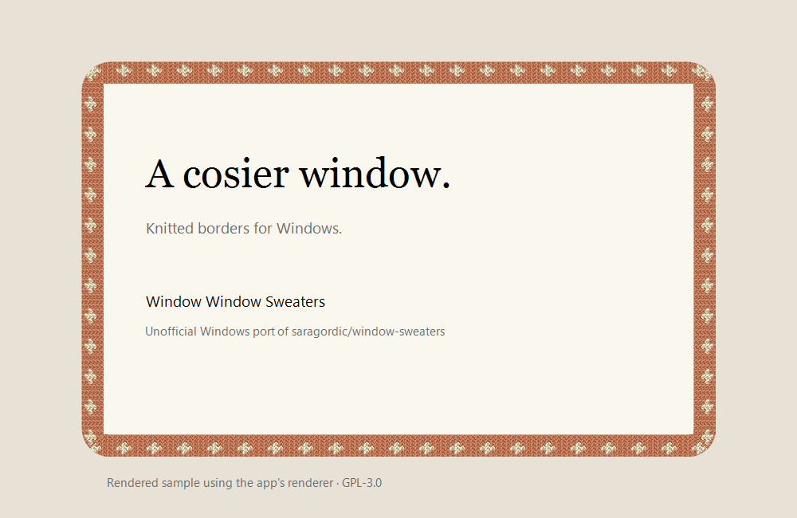

# Window Window Sweaters 🧶

**활성 창에 뜨개 테두리를 입히는 비공식 Windows 포트.**

An unofficial Windows adaptation of **[Window Sweaters by saragordic](https://github.com/saragordic/window-sweaters)**, itself based on **[JankyBorders by Felix Kratz](https://github.com/FelixKratz/JankyBorders)**. Original patterns, colourways and GPL-3.0 attribution are preserved. See [NOTICE.md](NOTICE.md).



## 다운로드 / Download

**[최신 Windows ZIP 받기 / Latest release](https://github.com/y5496694/window-window-sweaters/releases/latest)**

1. `WindowWindowSweaters-0.1.0-windows.zip`을 내려받아 쓰기 가능한 폴더에 압축을 풉니다.
2. `WindowWindowSweaters.exe`를 실행합니다. 설치나 관리자 권한은 필요하지 않습니다.
3. 일반 크기의 창을 선택하면 테두리가 나타납니다. 최대화 창은 기본적으로 제외됩니다.
4. 알림 영역의 **털실 아이콘 우클릭**으로 설정합니다. 아이콘이 숨겨져 있으면 `^` 메뉴를 엽니다. 더블클릭하면 미리보기가 나옵니다.

Extract the ZIP into a writable folder and run `WindowWindowSweaters.exe`. Right-click the yarn tray icon for settings, or double-click for a preview. No installer or administrator access is required. The release is unsigned.

**대상 환경:** Windows 10 1703 이상 또는 Windows 11, .NET Framework 4.8. .NET 8 SDK나 Python은 실행에 필요하지 않습니다. 현재 로컬 검증은 Windows 11 x64에서 했습니다. 다른 Windows 버전, ARM64, 혼합 DPI 모니터는 추가 검증이 필요합니다.

## 기능 / Features

- 활성 창을 따라가는 투명 테두리. 마우스 입력을 통과시키고 키보드 포커스를 가져오지 않습니다.
- 원작의 패턴 차트 47종과 앱 규칙 44개. Word, Excel, PowerPoint, Edge, Explorer, Terminal 등 Windows 실행 파일 이름에 맞춰 연결했습니다.
- 앱별 스타일, 지그재그, 기본 뜨개, 체크, 별, 땋기, 리본 등 공통 패턴.
- 앱별/파스텔/숲/회색 팔레트, 테두리 굵기, 코 크기, 앱 제외, 일시 정지.
- 최대화 창에는 선택적으로 **안쪽 12 physical px** 테두리를 표시합니다. 내용 가장자리에 겹칠 수 있으며 클릭은 통과합니다.
- 설정은 실행 파일 옆 `data/settings.ini`에 저장됩니다. 자동 시작 등록, 시스템 창 스타일 변경, 관리자 권한 요청, 네트워크 연결을 하지 않습니다.

## 범위와 제한 / Scope and limitations

**0.1.0은 활성 창 하나를 꾸미는 시제품입니다.** 원작처럼 모든 창에 동시에 테두리를 표시하지는 않습니다. 원작의 세부 실 질감과 일부 모서리 처리는 간소화했습니다.

창 크기를 바꾸는 동안에는 테두리를 잠깐 숨기고 크기가 안정되면 다시 그립니다. 전체 화면 창, 바탕 화면, 작업 표시줄, 최소화 창, 숨겨진 가상 데스크톱 창은 제외됩니다. 화면 가장자리에 붙은 창은 바깥쪽 테두리가 잘릴 수 있습니다. 관리자로 실행한 앱, 게임, 보안 데스크톱과 특수 창은 지원을 보장하지 않습니다. 최상위 투명 창을 쓰므로 다른 프로그램의 팝업이 뜨는 순간 테두리가 짧게 겹칠 수 있습니다.

This preview decorates **only the foreground window**, rather than every window simultaneously. Rendering differs from the macOS version. Fullscreen windows are skipped; maximized windows are skipped by default. Resize temporarily hides the border. Borders outside screen edges may be clipped. Other Windows versions, ARM64 and mixed-DPI monitor arrangements need further hands-on testing.

## 소스에서 빌드 / Build

Windows PowerShell에서 저장소 폴더를 열고:

```powershell
powershell -NoProfile -ExecutionPolicy Bypass -File .\build.ps1
```

결과: `bin/WindowWindowSweaters.exe`. Windows에 포함된 .NET Framework C# 컴파일러를 사용하며 NuGet 다운로드는 없습니다. .NET Framework 4.8을 대상으로 하는 C# 5 호환 소스입니다.

```powershell
# 실제 미리보기 창을 여는 검사 포함 / Includes a live test window
powershell -NoProfile -ExecutionPolicy Bypass -File .\build.ps1 -Test

# 미리보기 / Preview
.\bin\WindowWindowSweaters.exe --demo

# 종료 / Quit the running instance
.\bin\WindowWindowSweaters.exe --quit

# 실행 파일 + 동일 버전 소스 + 출처/라이선스 ZIP / Portable release
powershell -NoProfile -ExecutionPolicy Bypass -File .\package.ps1
```

차트 데이터를 다시 가져오려면 Python 3로 `python tools/import-collection.py <upstream-checkout>`을 실행합니다. 일반 빌드에는 Python이나 원작 저장소가 필요하지 않습니다.

## 검증 / Validation

`build.ps1 -Test`는 차트 크기, Windows 앱 이름 매칭, 색상 재현성, 설정 저장/복원, 47개 패턴의 투명 중심/불투명 테두리, 실제 창 이동/크기 변경/최소화/최대화, 포커스 유지, 클릭 통과 스타일, 정지/제외 처리, 반복 렌더링의 GDI 핸들 수를 확인합니다. 실제 마우스 입력 확인은 별도의 UI 확인으로 수행했습니다. 자동 검사는 인터랙티브 Windows 데스크톱이 필요합니다.

## 출처 / License

Original project: [saragordic/window-sweaters](https://github.com/saragordic/window-sweaters). Upstream base: [FelixKratz/JankyBorders](https://github.com/FelixKratz/JankyBorders).

Windows adaptation: [y5496694](https://github.com/y5496694). **GPL-3.0** — [LICENSE](LICENSE), [NOTICE.md](NOTICE.md). The release ZIP includes the corresponding source and build scripts.
